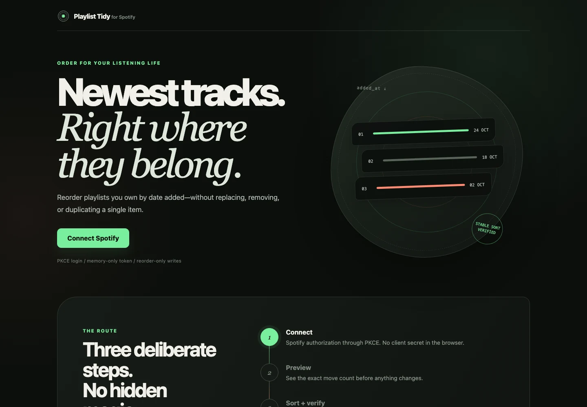
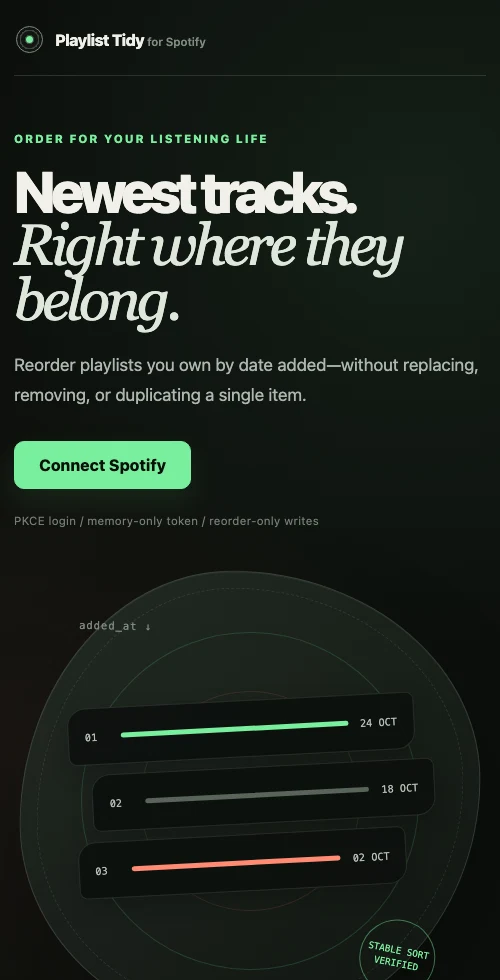

<!-- SPDX-License-Identifier: GPL-3.0-only -->
<!-- Copyright (C) 2026 AlbiDR -->

<p align="center">
  <picture>
    <source media="(prefers-color-scheme: dark)" srcset="docs/assets/readme/mark-dark.svg">
    
  </picture>
</p>

<h1 align="center">Playlist Tidy for Spotify</h1>

---

<p align="center">
  <strong>Put every playlist back in order.</strong><br>
  Preview first. Sort safely.
</p>

<p align="center">
  <a href="https://albidr.github.io/PlaylistTidy/">Open app</a> ·
  <a href="#how-it-works">How it works</a> ·
  <a href="#safety-by-design">Safety</a> ·
  <a href="#architecture">Architecture</a> ·
  <a href="#development">Develop</a>
</p>

<p align="center">
  <a href="https://github.com/AlbiDR/PlaylistTidy/actions/workflows/ci.yml"></a>
  <a href="https://github.com/AlbiDR/PlaylistTidy/actions/workflows/repository-policy.yml"></a>
  <a href="https://github.com/AlbiDR/PlaylistTidy/actions/workflows/pages.yml"></a>
  <a href="LICENSE"></a>
</p>

<p align="center">
  
</p>

Playlist Tidy is a focused Spotify utility for playlists owned by the authenticated user. It restores a stable, newest-added-first order without replacing, removing, or duplicating playlist contents.

> Playlist Tidy is an independent project and is not affiliated with or endorsed by Spotify. It is currently an early build: preview first and begin with a playlist you can restore.

## How it works

1. **Connect.** Authorize directly with Spotify through Authorization Code with PKCE.
2. **Choose.** Select a playlist owned by the authenticated account.
3. **Preview.** Read the complete playlist and calculate the exact reorder plan with zero writes.
4. **Confirm.** Start sorting only after an explicit user action.
5. **Verify.** Reconcile every write, then prove that membership and final ordering are correct.

<p align="center">
  
</p>

The narrow layout retains the same product hierarchy and safety contract; it does not collapse into a separate mobile experience.

## Behavioral contract

| Concern | Guarantee |
| --- | --- |
| Ordering | Stable newest-added-first; equal timestamps retain their relative order. |
| Missing dates | Occurrences without an addition date move below dated occurrences. |
| Membership | Duplicate, local, unavailable, and unidentified occurrences are preserved. |
| Preview | Reads and plans only; it performs zero Spotify writes. |
| Mutation | Uses Spotify's reorder operation only—never add, remove, replace, create, or delete. |
| Ownership | Refuses to sort a playlist not owned by the authenticated user. |
| Concurrency | Detects snapshot changes, replans within a fixed budget, and never hides ambiguous writes. |
| Completion | Verifies both membership and final ordering before reporting success. |

These are executable invariants, not interface promises. Their authoritative definitions live in the [CleanStack Architecture](docs/architecture/cleanstack.md).

## Safety by design

- The browser receives no Spotify client secret.
- Access tokens exist in memory only and disappear on reload.
- The one-time PKCE verifier and OAuth state use `sessionStorage` only during the redirect round trip and are deleted afterward.
- Refresh tokens returned to the website are discarded.
- Spotify access is limited to the scopes needed to read private playlists and reorder owned playlists.
- Playlist identifiers, OAuth artifacts, tokens, and private playlist contents must never enter Git history or public issues.

Report vulnerabilities through [GitHub private vulnerability reporting](https://github.com/AlbiDR/PlaylistTidy/security/advisories/new).

## Architecture

Dependency direction is inward:

```text
interfaces  →  applications  →  core
     │               ↑
     └── adapters ───┘
```

- `core/` owns occurrence identity, ordering, range transitions, and planning.
- `applications/` owns preview and sort orchestration through explicit ports.
- `adapters/` validates Spotify data and isolates OAuth and Web API behavior.
- `interfaces/` composes the browser experience without leaking UI concerns inward.
- Tests sit beside the modules whose contracts they specify.

Read the [authoritative architecture reference](docs/architecture/cleanstack.md) before changing a dependency boundary, playlist invariant, Spotify scope, or mutation type.

## Development

Requirements:

- Node.js 22.18 or newer
- npm with lockfile support
- A Spotify Development Mode application for authentication testing

```sh
npm ci --ignore-scripts
npm run verify
```

Run the local website:

```sh
cp .env.example .env
npm run dev
```

Set `VITE_SPOTIFY_CLIENT_ID` in `.env`. A Spotify Client ID is public application configuration; never add the Client Secret.

Register these Spotify redirect URIs exactly:

- Production: `https://albidr.github.io/PlaylistTidy/`
- Local website: `http://127.0.0.1:5173/`
- Reserved CLI enrollment: `http://127.0.0.1:8888/callback`

## Quality gate

`npm run verify` is the single local and CI acceptance command:

1. Verify current-year GPL-3.0-only notices and required repository metadata.
2. Verify approved human-only Git attribution.
3. Type-check product and repository tooling under strict TypeScript rules.
4. Enforce architectural and code-quality lint rules.
5. Run the complete automated test suite.
6. Produce clean web and CLI-library builds.

GitHub repeats those controls across independent Verify, Repository Policy, Contributor Attribution Policy, and Pages workflows. Actions use least-privilege permissions, immutable revisions, bounded runtimes, non-persistent checkout credentials, and concurrency cancellation.

## Repository map

```text
.
├── .github/   Governance, ownership, issue forms, and workflows
├── config/    TypeScript, ESLint, Vitest, and Vite configuration
├── docs/      Architecture, README assets, and project documentation
├── scripts/   Typed cleanup and repository-policy checks
└── src/       Product code, interfaces, colocated tests, and test support
```

The root is reserved for project identity, the npm manifest and lockfile, and conventional dotfiles consumed directly by development tools.

## Contributing

Read [.github/CONTRIBUTING.md](.github/CONTRIBUTING.md) before changing behavior or architecture. Pull requests must be focused, preserve the Spotify mutation boundary, and pass `npm run verify`.

Repository history attributes work only to the humans responsible for its commits. Automated systems, bots, and AI tools must never be named as authors or co-authors; the complete Git history is checked on every push and pull request.

## License

[GPL-3.0-only](LICENSE), copyright 2026 AlbiDR.
